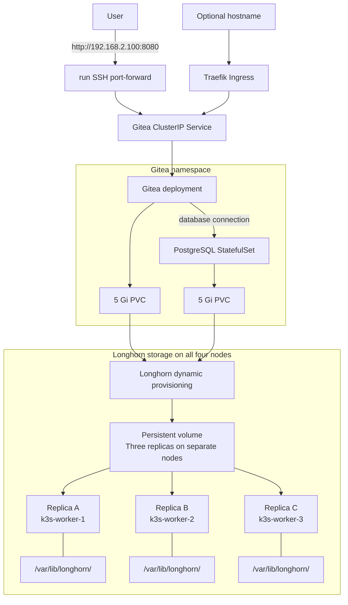
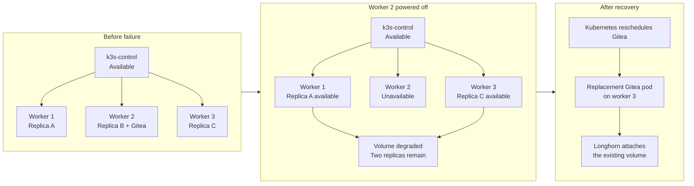

# Proxmox + K3s + Gitea Lab

Homelab infrastructure-as-code: four Debian VMs on Proxmox, K3s bootstrapped via Cloud-Init, Gitea via Helm, Longhorn distributed storage, and Prometheus + Grafana monitoring.

## Architecture

See the separate [deployment and cluster architecture](docs/deployment-cluster-architecture.md) page.

### Applications and distributed storage



### Worker failure and recovery



When worker 2 returns, Longhorn restores its replica and the volume returns to a healthy state. Repository data is preserved throughout this example.

## Quick Start

Run these commands on the Debian administration VM:

```bash
# Load the SSH key used for Proxmox and the cluster
ssh-add ~/.ssh/id_ed25519

# Create the VMs and install K3s, Longhorn, and Gitea
./deploy

# Open persistent access to Gitea
./run start
```

Open `http://192.168.2.100:8080` and log in as `admin`. The deployment prompts for the Proxmox API token and Gitea administrator password. Settings are saved in `.proxmox-env` with owner-only permissions and reused on later runs. Missing exports are also appended to existing `.bashrc` and `.zshrc` files.

Use `./deploy --reconfigure` to replace saved credentials and `./deploy --help` for all options.

### Manage Gitea access

```bash
./run start       # Start in the background; survives SSH logout
./run status      # Check the process and display the URL
./run stop        # Stop access
./run restart     # Restart access
./run foreground  # Optional terminal-bound mode
./run --help      # Manual and environment overrides
```

The background PID and log are stored in `~/.local/state/proxmox-k3s-gitea/`.

### Prometheus and Grafana

The main deployment installs `kube-prometheus-stack` in the `monitoring` namespace. Open Grafana at `http://192.168.2.100:30090` and log in as `admin`; its initial password matches `GITEA_ADMIN_PASSWORD` unless `GRAFANA_ADMIN_PASSWORD` is set.

Prometheus retains 15 days of node, Pod, container, disk, network, and Longhorn metrics on a 20 Gi Longhorn volume. Node Exporter reports CPU, memory, filesystem, disk I/O, and network usage for every VM. kube-state-metrics reports Kubernetes resource health and container consumption. Grafana includes prebuilt dashboards for cluster and node history, including CPU, memory, disk, network, and Pod usage over selectable time ranges.

To reinstall only monitoring, copy `06-monitoring/` to the control plane and run `sudo ./06-monitoring/install` with `GRAFANA_ADMIN_PASSWORD` set.

### Service access

| Service | Address or port | Access method |
|---------|-----------------|---------------|
| Proxmox | `https://192.168.2.22:8006` | Direct web interface |
| Gitea | `http://192.168.2.100:8080` | Start with `./run start` |
| Ruby build dashboard | `http://192.168.2.100:30080` | NodePort, available after `./deploy-ruby` |
| Grafana | `http://192.168.2.100:30090` | NodePort, installed by `./deploy` |
| Kubernetes API | `192.168.2.100:6443` | Administrative access with kubeconfig |
| Prometheus | `192.168.2.100:9090` | Port-forward, command below |
| Longhorn UI | `192.168.2.100:8081` | Port-forward, command below |

Prometheus and the Longhorn UI remain internal ClusterIP services. To access them temporarily, run these commands on the control plane:

```bash
sudo kubectl -n monitoring port-forward svc/monitoring-kube-prometheus-prometheus 9090:9090 --address 0.0.0.0
sudo kubectl -n longhorn-system port-forward svc/longhorn-frontend 8081:80 --address 0.0.0.0
```

### Deploy the Ruby build lab

After creating the `admin/ruby` repository in Gitea:

```bash
./deploy-ruby
```

The script requests the internal Gitea URL, repository name, Actions runner registration token, and release publishing token. Use `http://gitea.gitea.svc.cluster.local` and `admin/ruby` for this lab. Settings are saved in `.ruby-build.env`; run `./deploy-ruby --reconfigure` after rotating credentials.

Three Gentoo builders compile and test Ruby as an unprivileged user, publish releases to Gitea, and send metrics to `http://192.168.2.100:30080`. See [the Ruby builder guide](05-ruby-build/README.md) for token setup and monitoring.

### Monitor and diagnose

```bash
./monitor                  # Live nodes, Pods, Services, PVs, PVCs, and logs
./monitor --interval 10    # Refresh every ten seconds
./monitor --once           # Fetch one snapshot
./diagnose                 # Full checks plus a ZIP archive in /tmp
```

The monitor displays recent K3s logs from the control plane and all workers, plus the latest Ruby builder logs. Diagnostics are saved as `/tmp/k3s-diagnostics-<timestamp>.zip`; the `zip` package is required on the administration VM.

## Repository Layout

| Path | Purpose |
|------|---------|
| `01-vms/` | Terraform: Proxmox VMs + Cloud-Init |
| `02-kubernetes/` | Cluster readiness, Helm + K9s install |
| `03-gitea/` | Gitea Helm deployment |
| `04-longhorn/` | Longhorn distributed storage |
| `05-ruby-build/` | Gentoo Ruby builders, Gitea runners, and metrics dashboard |
| `06-monitoring/` | Prometheus history and Grafana dashboards |
| `deploy` | One-shot deploy from scratch |
| `deploy-ruby` | Deploy three Ruby builders and the metrics dashboard |
| `destroy` | Complete teardown |
| `diagnose` | Health check all layers |
| `run` | Port-forward to access Gitea |
| `install-terraform-debian` | Install Terraform on Debian 12 |
| `docs/superpowers/` | Implementation plans + design specs |

## Storage

| Class | Backend | Access | Replicas | Default |
|-------|---------|--------|----------|---------|
| `longhorn` | Longhorn | RWO | 3 | Yes |
| `longhorn-rwx` | Longhorn | RWX | 3 | No |
| `local-path` | Host disk | RWO | 1 | No |

## Secrets

- `PROXMOX_VE_API_TOKEN` — environment variable, never committed
- `GITEA_ADMIN_PASSWORD` — environment variable, passed to installer
- K3s token — generated by Terraform `random_password`, stored in state

## Design Docs

- [Deployment and cluster architecture](docs/deployment-cluster-architecture.md)
- [Proxmox-K3s-Gitea Design](docs/superpowers/specs/2026-10-26-proxmox-k3s-gitea-design.md)
- [Longhorn RWX Design](docs/superpowers/specs/2026-10-26-longhorn-rwx-design.md)
- [Implementation Plan](docs/superpowers/plans/2026-10-26-proxmox-k3s-gitea.md)
