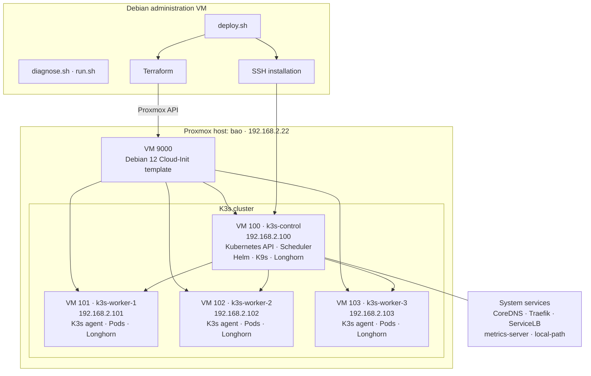
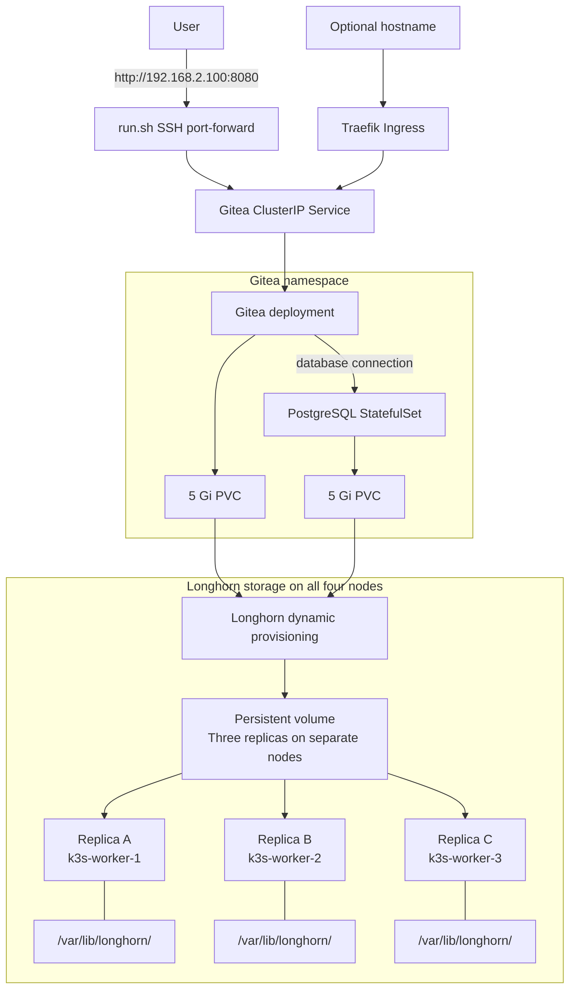
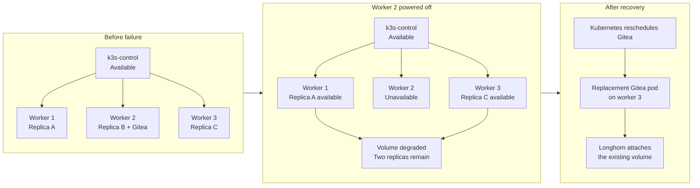

# Proxmox + K3s + Gitea Lab

Homelab infrastructure-as-code: four Debian VMs on Proxmox, K3s bootstrapped via Cloud-Init, Gitea via Helm, and Longhorn distributed storage by default.

## Architecture

### Deployment and cluster



### Applications and distributed storage



### Worker failure and recovery



When worker 2 returns, Longhorn restores its replica and the volume returns to a healthy state. Repository data is preserved throughout this example.

## Quick Start

Run these commands on the Debian administration VM:

```bash
# Load the SSH key used for Proxmox and the cluster
ssh-add ~/.ssh/id_ed25519

# Create the VMs and install K3s, Longhorn, and Gitea
./deploy.sh

# Open persistent access to Gitea
./run.sh start
```

Open `http://192.168.2.100:8080` and log in as `admin`. The deployment prompts for the Proxmox API token and Gitea administrator password. Settings are saved in `.proxmox-env` with owner-only permissions and reused on later runs. Missing exports are also appended to existing `.bashrc` and `.zshrc` files.

Use `./deploy.sh --reconfigure` to replace saved credentials and `./deploy.sh --help` for all options.

### Manage Gitea access

```bash
./run.sh start       # Start in the background; survives SSH logout
./run.sh status      # Check the process and display the URL
./run.sh stop        # Stop access
./run.sh restart     # Restart access
./run.sh foreground  # Optional terminal-bound mode
./run.sh --help      # Manual and environment overrides
```

The background PID and log are stored in `~/.local/state/proxmox-k3s-gitea/`.

### Deploy the Ruby build lab

After creating the `admin/ruby` repository in Gitea:

```bash
./deploy-ruby.sh
```

The script requests the internal Gitea URL, repository name, Actions runner registration token, and release publishing token. Use `http://gitea.gitea.svc.cluster.local` and `admin/ruby` for this lab. Settings are saved in `.ruby-build.env`; run `./deploy-ruby.sh --reconfigure` after rotating credentials.

Three Gentoo builders compile and test Ruby as an unprivileged user, publish releases to Gitea, and send metrics to `http://192.168.2.100:30080`. See [the Ruby builder guide](05-ruby-build/README.md) for token setup and monitoring.

## Repository Layout

| Path | Purpose |
|------|---------|
| `01-vms/` | Terraform: Proxmox VMs + Cloud-Init |
| `02-kubernetes/` | Cluster readiness, Helm + K9s install |
| `03-gitea/` | Gitea Helm deployment |
| `04-longhorn/` | Longhorn distributed storage |
| `05-ruby-build/` | Gentoo Ruby builders, Gitea runners, and metrics dashboard |
| `deploy.sh` | One-shot deploy from scratch |
| `deploy-ruby.sh` | Deploy three Ruby builders and the metrics dashboard |
| `destroy.sh` | Complete teardown |
| `diagnose.sh` | Health check all layers |
| `run.sh` | Port-forward to access Gitea |
| `install-terraform-debian.sh` | Install Terraform on Debian 12 |
| `docs/superpowers/` | Implementation plans + design specs |

## Storage

| Class | Backend | Access | Replicas | Default |
|-------|---------|--------|----------|---------|
| `longhorn` | Longhorn | RWO | 3 | Yes |
| `longhorn-rwx` | Longhorn | RWX | 3 | No |
| `local-path` | Host disk | RWO | 1 | No |

## Secrets

- `PROXMOX_VE_API_TOKEN` — environment variable, never committed
- `GITEA_ADMIN_PASSWORD` — environment variable, passed to installer
- K3s token — generated by Terraform `random_password`, stored in state

## Design Docs

- [Proxmox-K3s-Gitea Design](docs/superpowers/specs/2026-10-26-proxmox-k3s-gitea-design.md)
- [Longhorn RWX Design](docs/superpowers/specs/2026-10-26-longhorn-rwx-design.md)
- [Implementation Plan](docs/superpowers/plans/2026-10-26-proxmox-k3s-gitea.md)
