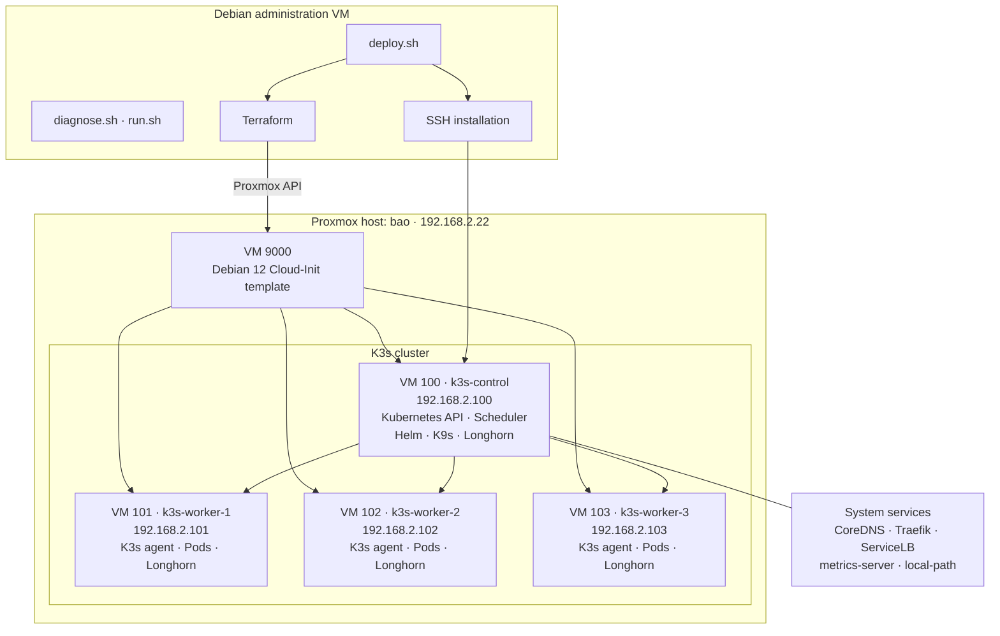
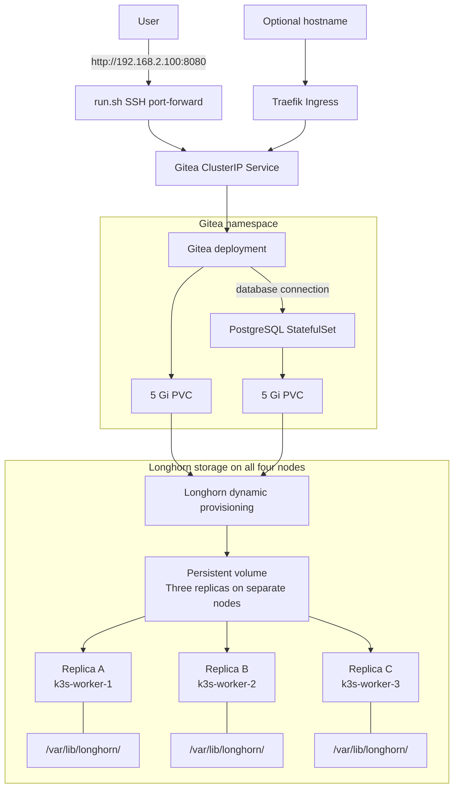
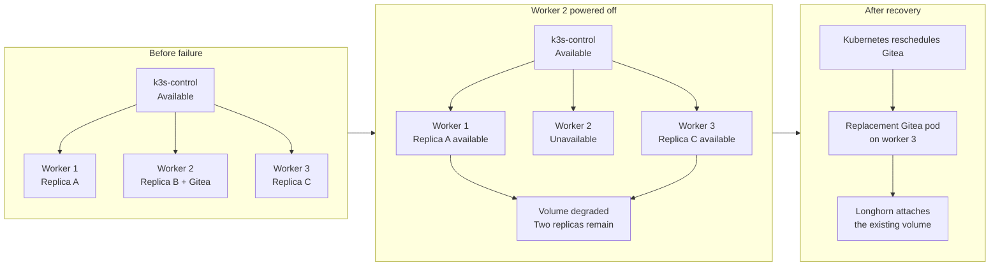

# Proxmox + K3s + Gitea Lab

Homelab infrastructure-as-code: four Debian VMs on Proxmox, K3s bootstrapped via Cloud-Init, Gitea via Helm, and Longhorn distributed storage by default.

## Architecture

### Deployment and cluster



### Applications and distributed storage



### Worker failure and recovery



When worker 2 returns, Longhorn restores its replica and the volume returns to a healthy state. Repository data is preserved throughout this example.

## Quick Start

```bash
# 1. Proxmox credentials and SSH key in agent
export PROXMOX_VE_API_TOKEN="root@pam!tokenname=uuid"
ssh-add ~/.ssh/id_ed25519

# 2. Create VMs (Terraform)
cp 01-vms/terraform.tfvars.example 01-vms/terraform.tfvars
# edit 01-vms/terraform.tfvars
01-vms/install-providers.sh
TF_CLI_CONFIG_FILE="$PWD/01-vms/.terraform-provider-mirror/terraform.rc" terraform -chdir=01-vms init
terraform -chdir=01-vms apply

# 3. Full deploy (includes Longhorn + Gitea)
export GITEA_ADMIN_PASSWORD='choose-strong-password'
./deploy.sh

# 4. Access Gitea
./run.sh
```

## Repository Layout

| Path | Purpose |
|------|---------|
| `01-vms/` | Terraform: Proxmox VMs + Cloud-Init |
| `02-kubernetes/` | Cluster readiness, Helm + K9s install |
| `03-gitea/` | Gitea Helm deployment |
| `04-longhorn/` | Longhorn distributed storage |
| `deploy.sh` | One-shot deploy from scratch |
| `destroy.sh` | Complete teardown |
| `diagnose.sh` | Health check all layers |
| `run.sh` | Port-forward to access Gitea |
| `install-terraform-debian.sh` | Install Terraform on Debian 12 |
| `docs/superpowers/` | Implementation plans + design specs |

## Storage

| Class | Backend | Access | Replicas | Default |
|-------|---------|--------|----------|---------|
| `longhorn` | Longhorn | RWO | 3 | Yes |
| `longhorn-rwx` | Longhorn | RWX | 3 | No |
| `local-path` | Host disk | RWO | 1 | No |

## Secrets

- `PROXMOX_VE_API_TOKEN` — environment variable, never committed
- `GITEA_ADMIN_PASSWORD` — environment variable, passed to installer
- K3s token — generated by Terraform `random_password`, stored in state

## Design Docs

- [Proxmox-K3s-Gitea Design](docs/superpowers/specs/2026-10-26-proxmox-k3s-gitea-design.md)
- [Longhorn RWX Design](docs/superpowers/specs/2026-10-26-longhorn-rwx-design.md)
- [Implementation Plan](docs/superpowers/plans/2026-10-26-proxmox-k3s-gitea.md)
