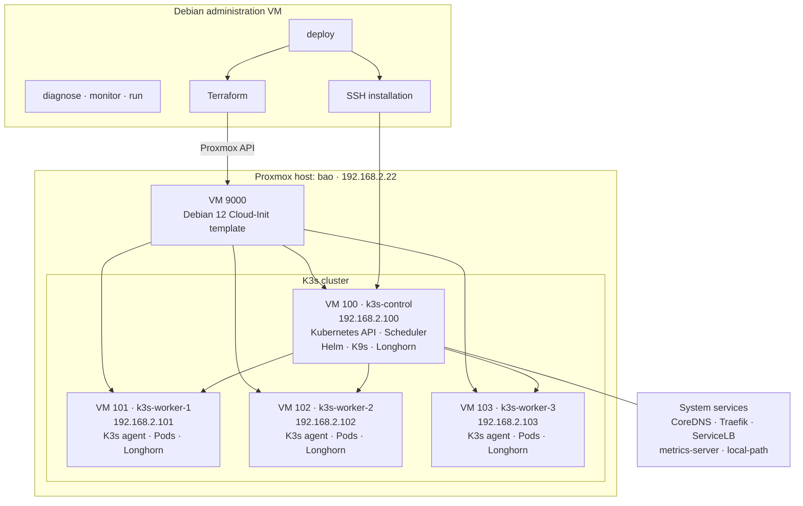

# Deployment and cluster architecture

The Debian administration VM runs Terraform and the deployment scripts. Terraform creates four Debian VMs on Proxmox; Cloud-Init bootstraps K3s, with one control plane and three workers.

The main deployment also installs Longhorn, Gitea, Prometheus, and Grafana. The three workers host the Gentoo Ruby builders and their Gitea Actions runners.
