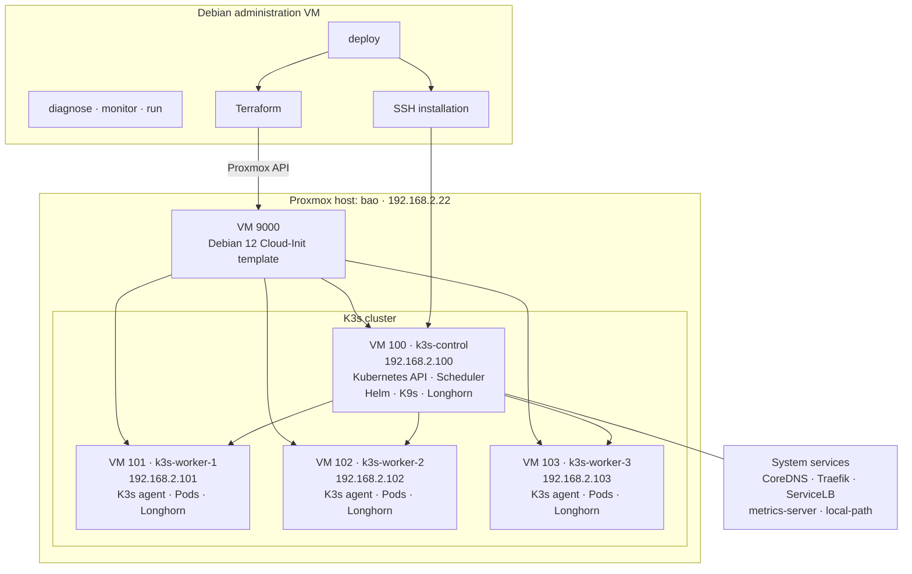
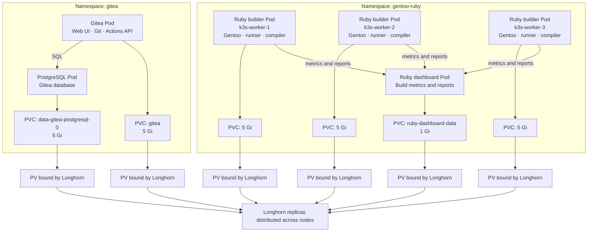
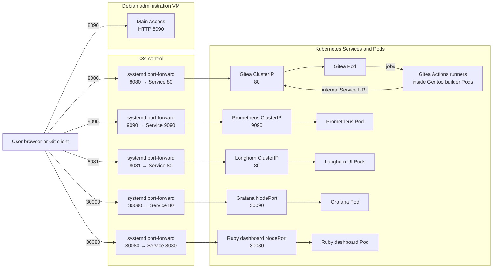

# Deployment and cluster architecture

The Debian administration VM runs Terraform and the deployment scripts. Terraform creates four Debian VMs on Proxmox; Cloud-Init bootstraps K3s, with one control plane and three workers.

The main deployment also installs Longhorn, Gitea, Prometheus, and Grafana. The three workers host the Gentoo Ruby builders and their Gitea Actions runners.

## Workloads and persistent storage

A **Pod** is a running workload. A **PersistentVolumeClaim (PVC)** is a workload's request for storage. Kubernetes binds that claim to a **PersistentVolume (PV)**, which Longhorn implements as replicated storage. Deleting or recreating a Pod does not delete its PVC, so Gitea repositories, build data, and metrics can survive rescheduling.

Gitea Pods serve users and automation continuously. Ruby builder Pods are isolated Gentoo environments that compile and test Ruby, publish releases back to Gitea, and upload metrics to their own dashboard. Their compute workloads are separate from Gitea even though they use the same cluster and storage backend.

## Network and service access

Gitea, Prometheus, and Longhorn are ClusterIP services exposed to the lab through systemd-managed port-forwards. Grafana and the Ruby dashboard also have NodePorts. Runners use Gitea's internal Service DNS name, so they do not depend on an external port-forward remaining active.
